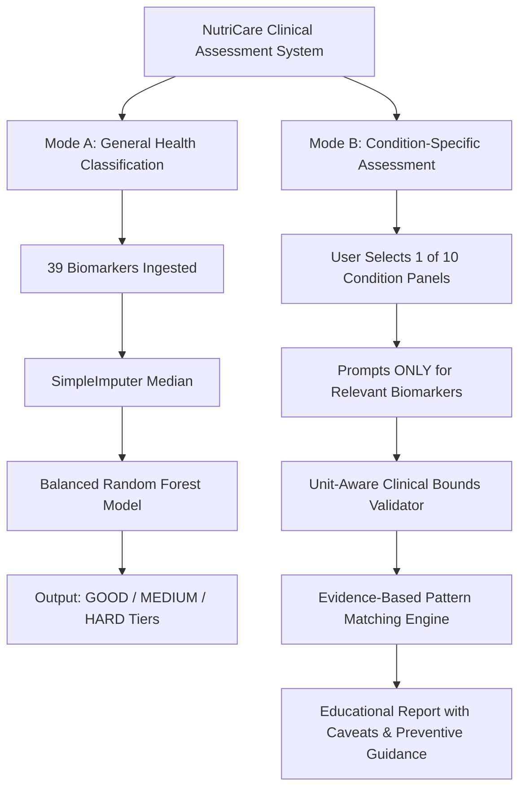

# NutriCare -- Blood Biomarker Analysis & Disease Pattern Assessment

A comprehensive, standalone health-data machine learning and clinical pattern assessment system demonstrating biomarker classification into three synthetic health tiers (**GOOD**, **MEDIUM**, **HARD**) and targeted, unit-aware **condition-specific pattern evaluations** across 10 clinical panels.

> **CRITICAL EDUCATIONAL & MEDICAL DISCLAIMER**  
> This project is designed strictly for **academic, educational, and technical demonstration** purposes.  
> - **NOT A MEDICAL DEVICE OR DIAGNOSTIC TOOL**: This software must **NEVER** be used for clinical diagnosis, patient triage, or treatment planning.  
> - **SYNTHETIC DATASET**: The underlying dataset contains synthetic biomarker values and rule-derived labels. High model accuracy reflects the algorithm learning synthetic threshold rules, **NOT** real-world medical diagnostic efficacy.  
> - **NO DISEASE-SPECIFIC SUPERVISED LABELS**: The dataset does **not** contain ground-truth clinical diagnostic labels for specific diseases. Condition assessments in Mode B are transparent, rule-based demonstrations grounded in clinical practice guidelines, **not** black-box supervised classifiers.  
> - **ALWAYS SEEK PROFESSIONAL CARE**: Any abnormal pattern warrants evaluation by a qualified, licensed physician.

---

## Table of Contents
1. [Project Overview & Dual Architecture](#1-project-overview--dual-architecture)
2. [Project Architecture & Directory Structure](#2-project-architecture--directory-structure)
3. [The 39 Biomarkers & Clinical Panels](#3-the-39-biomarkers--clinical-panels)
4. [Input Validation & Unit-Mismatch Engine](#4-input-validation--unit-mismatch-engine)
5. [Condition-Specific Clinical Pattern Engine (10 Panels)](#5-condition-specific-clinical-pattern-engine-10-panels)
6. [Installation & Setup](#6-installation--setup)
7. [Training the Supervised Model](#7-training-the-supervised-model)
8. [Running Assessments & Predictions (Dual Modes)](#8-running-assessments--predictions-dual-modes)
9. [Automated Testing & Verification](#9-automated-testing--verification)
10. [Evaluation Results (Mode A)](#10-evaluation-results-mode-a)
11. [Scientific Limitations & Supervised ML Requirements](#11-scientific-limitations--supervised-ml-requirements)
12. [Key ML & Clinical Concepts for Viva](#12-key-ml--clinical-concepts-for-viva)

---

## 1. Project Overview & Dual Architecture

NutriCare provides two complementary, modular workflows:



### Mode A: General Health Classification (Supervised ML)
- Uses an ensemble `RandomForestClassifier` trained on all 39 biomarkers to predict composite synthetic categories (`GOOD`, `MEDIUM`, `HARD`).
- Features automated missing data imputation, class-weight balancing, and stratified train/test partitioning.

### Mode B: Condition-Specific Pattern Assessment (Targeted Clinical Panels)
- Eliminates user fatigue: users select a specific condition and are prompted **only for relevant biomarkers** with documented units.
- Validates inputs against physiological boundaries, catches non-numeric/negative errors, and detects **international unit mismatches** (e.g., glucose in mmol/L vs mg/dL, creatinine in µmol/L vs mg/dL).
- Assesses biomarker patterns against published medical consensus guidelines (ADA, WHO, KDIGO, AHA/ACC, ACG, ATA, Endocrine Society, BSH).
- Provides comprehensive educational narratives, differential diagnoses, unmeasured test caveats, and preventive lifestyle guidance.

---

## 2. Project Architecture & Directory Structure

```
NutriCare-ML/
├── .gitignore                         # Git ignore rules (venv, bytecode, outputs)
├── Process.md                         # Permanent technical handover & audit log
├── README.md                          # Comprehensive system documentation
├── requirements.txt                   # Pinned Python package dependencies
├── TrainData.xlsx                     # Biomarker workbook (6 sheets)
├── train.py                           # Training orchestration script
├── predict.py                         # Dual-mode prediction & assessment CLI
├── models/
│   ├── nutricare_model.pkl            # Serialized Pipeline (median imputer + Random Forest)
│   └── model_metadata.json            # Feature schema, metrics, and training metadata
├── outputs/
│   ├── validation_report.txt          # Automated 12-point dataset audit report
│   ├── evaluation_report.txt          # Test metrics, classification report & confusion matrix
│   ├── disease_mapping_report.md      # Comprehensive biomarker audit & disease taxonomy
│   └── confusion_matrix.png           # High-resolution heatmap of confusion matrix
├── src/
│   ├── __init__.py                    # Package initializer
│   ├── config.py                      # Centralized constants, paths & hyperparameters
│   ├── data_loader.py                 # Excel loader, 12-point validator & feature splitter
│   ├── trainer.py                     # Pipeline builder, evaluator & artifact persistence
│   ├── biomarker_validation.py        # Clinical bound validator & unit-mismatch detector
│   ├── disease_patterns.py            # Rule-based pattern matching for 10 condition panels
│   └── disease_explainer.py           # Educational condition explainer & lifestyle guidance
└── tests/
    └── test_biomarker_validation.py   # Automated unit tests (19 test cases)
```

---

## 3. The 39 Biomarkers & Clinical Panels

The 39 continuous numeric biomarkers in `TrainData.xlsx` are grouped into physiological panels:

| Panel | Biomarkers Included | Canonical Units | Key Clinical Roles |
|---|---|---|---|
| **Metabolic & Glycemic** | `Glucose_mg_dL`, `HbA1c_pct` | mg/dL, % | Acute blood sugar and 3-month average glycemia |
| **Complete Blood Count (CBC)** | `Hemoglobin_g_dL`, `RBC_10^12_L`, `MCV_fL`, `MCH_pg`, `MCHC_g_dL`, `RDW_pct`, `WBC_10^9_L`, `Platelet_10^9_L`, `Neutrophil_10^9_L`, `Lymphocyte_10^9_L` | g/dL, $10^{12}/\text{L}$, fL, pg, g/dL, %, $10^9/\text{L}$ | Erythrocyte size/mass, oxygenation, infection, and platelet hemostasis |
| **Lipid Profile & Atherogenesis** | `Total_Cholesterol_mg_dL`, `LDL_Cholesterol_mg_dL`, `HDL_Cholesterol_mg_dL`, `Triglycerides_mg_dL`, `ApoB_mg_dL`, `Lipoprotein_a_mg_dL` | mg/dL | Circulating cholesterol, atherogenic particles (ApoB), and genetic cardiovascular risk (Lp(a)) |
| **Renal Function Panel** | `Creatinine_mg_dL`, `eGFR_mL_min_1_73m2`, `Urea_mg_dL`, `UACR_mg_g` (urine) | mg/dL, $\text{mL/min/1.73m}^2$, mg/dL, mg/g | Glomerular filtration, nitrogenous waste, and microvascular permeability |
| **Hepatic Chemistries** | `ALT_U_L`, `AST_U_L`, `ALP_U_L`, `Bilirubin_mg_dL`, `GGT_U_L`, `Albumin_g_dL` | U/L, mg/dL, g/dL | Hepatocellular injury, biliary cholestasis, and hepatic protein synthesis |
| **Endocrine & Thyroid** | `TSH_mIU_L` | mIU/L | Anterior pituitary regulator of thyroid hormone secretion |
| **Vitamins & Minerals** | `Vitamin_D_ng_mL`, `Vitamin_B12_pg_mL`, `Folate_ng_mL`, `Ferritin_ng_mL` | ng/mL, pg/mL, ng/mL, ng/mL | Bone mineral metabolism, DNA synthesis, and total body iron storage |
| **Electrolytes** | `Sodium_mmol_L`, `Potassium_mmol_L`, `Calcium_mg_dL`, `Magnesium_mg_dL` | mmol/L, mg/dL | Transmembrane neuromuscular excitability and cardiac rhythm regulation |
| **Vascular & Inflammatory** | `CRP_mg_L`, `Homocysteine_umol_L` | mg/L, µmol/L | Systemic acute-phase inflammation and one-carbon methylation |

*(Note: `Record_ID` is a non-clinical string identifier and is strictly excluded from all models. `UACR_mg_g` is a urine measurement; all other analytes are serum or whole blood).*

---

## 4. Input Validation & Unit-Mismatch Engine

The `BiomarkerValidator` module in `src/biomarker_validation.py` provides unit-aware input validation:

1. **Non-Numeric & Malformed Input**: Rejects alphabetic characters, invalid floats, `NaN`, and infinities.
2. **Physiologically Impossible Values**: Catches negative numbers and values outside biological survival limits (e.g., negative HbA1c, 0 WBC, HbA1c > 25%).
3. **Suspicious International Unit Mismatches**:
   - **Glucose**: Values in 2.0 - 30.0 range trigger a warning: *"Did you enter glucose in mmol/L instead of mg/dL?"*
   - **Creatinine**: Values in 40.0 - 1500.0 range trigger a warning: *"Did you enter creatinine in µmol/L instead of mg/dL?"*
   - **Cholesterol**: Values in 2.0 - 15.0 range trigger a warning: *"Did you enter total cholesterol in mmol/L instead of mg/dL?"*
   - **Hemoglobin**: Values in 50.0 - 220.0 range trigger a warning: *"Did you enter hemoglobin in g/L instead of g/dL?"*
   - **Calcium**: Values in 1.5 - 3.5 range trigger a warning: *"Did you enter calcium in mmol/L instead of mg/dL?"*
4. **Critical / Panic Laboratory Alerts**: Flags acute life-threatening derangements (e.g., Potassium < 2.8 or > 6.2 mmol/L, Sodium < 120 or > 155 mmol/L, Platelets < 30) requiring immediate medical attention.
5. **No Silent Imputation or Clipping**: Invalid inputs are clearly reported with specific diagnostic messages without silent data alteration.

---

## 5. Condition-Specific Clinical Pattern Engine (10 Panels)

The `DiseasePatternEngine` in `src/disease_patterns.py` evaluates targeted panels:

1. **Diabetes-Related Screening**: Evaluates `Glucose_mg_dL` and `HbA1c_pct` against ADA consensus criteria (Normal: HbA1c < 5.7%; Prediabetes: 5.7%-6.4%; Diabetic Range: $\ge 6.5\%$). Discrepancies between acute glucose and chronic HbA1c are flagged.
2. **Anemia Patterns (Morphologic Classification)**: Evaluates `Hemoglobin_g_dL` and categorizes morphology via `MCV_fL` (Microcytic <80 fL, Normocytic 80-100 fL, Macrocytic >100 fL) with `RDW_pct` anisocytosis assessment.
3. **Iron Deficiency Patterns**: Evaluates `Ferritin_ng_mL` (depleted stores <30 ng/mL, severe depletion <15 ng/mL) alongside hemoglobin, MCV, and `CRP_mg_L` to identify functional iron deficiency.
4. **Cholesterol & Lipid Abnormalities**: Evaluates Total Cholesterol, LDL, HDL, Triglycerides, `ApoB_mg_dL`, and `Lipoprotein_a_mg_dL` against NCEP ATP III / AHA guidelines.
5. **Kidney Function Abnormalities**: Evaluates `Creatinine_mg_dL`, `eGFR_mL_min_1_73m2` (KDIGO Stages G1 to G5), `Urea_mg_dL`, and urine albuminuria (`UACR_mg_g` Stages A1 to A3).
6. **Liver-Related Abnormalities**: Differentiates hepatocellular injury (ALT/AST $\ge 3\times$ ULN), cholestasis (concordant ALP and GGT elevation), and hyperbilirubinemia.
7. **Thyroid Dysfunction Indicators**: Evaluates `TSH_mIU_L` for suspected primary hypothyroidism (>4.0 mIU/L) or hyperthyroidism (<0.4 mIU/L), documenting the absence of Free T4/T3.
8. **Vitamin D Deficiency Patterns**: Evaluates `Vitamin_D_ng_mL` (Deficiency <20 ng/mL, Severe <12 ng/mL) and concomitant calcium/ALP changes.
9. **Vitamin B12 & Folate Deficiency**: Evaluates B12, folate, `Homocysteine_umol_L`, and macrocytosis.
10. **Electrolyte Abnormalities**: Evaluates sodium, potassium, calcium (with albumin correction), and magnesium for critical conduction or osmolar risks.

---

## 6. Installation & Setup

### Prerequisites
- Python 3.10, 3.11, 3.12, or 3.13 installed
- Windows, macOS, or Linux

### Installation Commands

```bash
# 1. Navigate to project root
cd NutriCare-ML

# 2. Create virtual environment
python -m venv venv

# 3. Activate virtual environment
# Windows (PowerShell):
.\venv\Scripts\Activate.ps1
# Windows (Command Prompt):
.\venv\Scripts\activate.bat
# macOS / Linux:
source venv/bin/activate

# 4. Install dependencies
pip install -r requirements.txt
```

---

## 7. Training the Supervised Model

To execute the data validation, training, and evaluation pipeline:

```bash
python train.py
```

This validates `TrainData.xlsx`, fits the median imputer and balanced Random Forest classifier, evaluates on a 20% stratified test split, and generates:
- `models/nutricare_model.pkl`
- `models/model_metadata.json`
- `outputs/validation_report.txt`
- `outputs/evaluation_report.txt`
- `outputs/confusion_matrix.png`

---

## 8. Interactive Terminal Dashboard & CLI (Dual Modes)

### Primary Interface: Gemini-Inspired Interactive Terminal Dashboard
Launch the full interactive dark-mode terminal dashboard built with Textual:

```bash
python app.py
```

The NutriCare Terminal Dashboard features:
- **Gemini-Inspired Visual Identity**: Horizontal true-color gradient ASCII brand wordmark (`#5294E2` -> `#7585E8` -> `#A879D5` -> `#D46A9B`), subtle dotted borders, and custom theme tokens.
- **Responsive Multi-Panel Layout**:
  - **Panel A (ML Model)**: Real-time specifications, training metadata, and verified test metrics (98.00% accuracy, 0.9552 Macro-F1).
  - **Panel B (Conditions)**: Instant access to 10 clinical panels with required biomarker lists.
  - **Panel C (Dataset)**: Read-only overview of the 1,000 synthetic records, 39 features, and missingness summary.
  - **Panel D (Session History)**: In-memory live session assessment audit trail.
  - **Panel E (System Status)**: Diagnostic check of model, dataset, rules engine, and validation modules.
- **Intuitive Keyboard Navigation**:
  - `[1]` Dashboard
  - `[2]` General ML Biomarker Classification (with Good / Okay / Poor demo presets)
  - `[3]` Condition Assessment (10 targeted clinical panels)
  - `[4]` Model Evaluation Report & Confusion Matrix
  - `[5]` Dataset Explorer & Feature Dictionary
  - `[6]` Session History
  - `[7]` About & Clinical Consensus References
  - `[Q]` Exit | `[Esc]` Back

### Display Label Mapping (General Biomarker Classification)
The supervised Random Forest model predicts three synthetic health tiers, mapped to clear, intuitive display categories:
- **GOOD** -> `Good` (All 39 biomarkers within normal reference intervals)
- **MEDIUM** -> `Okay` (Moderate elevation or 1-2 mild flags based on M1-M6 threshold rules)
- **HARD** -> `Poor` (Critical lab thresholds breached based on H1-H4 severity rules)

> *Notice: These categories reflect learned mathematical patterns from synthetic training data, NOT clinical diagnoses.*

### Clinical Safety & Critical Alert Priority
In targeted condition assessments (Mode B), critical laboratory values (e.g. panic hypocalcemia `< 6.5 mg/dL`, severe hyperkalemia `> 6.5 mmol/L`, severe diabetic crisis `> 400 mg/dL`) automatically trigger `CRITICAL_ALERT` / `ABNORMAL_PATTERN` status elevation. Critical lab alerts are pinned prominently at the top of the assessment report, ensuring life-threatening derangements are never masked by otherwise normal rule findings.

### CLI Alternative Interface
The command-line interface remains fully available for scripting and headless automation:

```bash
# Interactive CLI Menu
python predict.py

# Run Mode A Demonstration (Synthetic Good / Okay / Poor samples)
python predict.py --demo

# Run Mode B Demonstration (Targeted Condition Panels)
python predict.py --demo-conditions

# Launch Mode B Interactive Assessment
python predict.py --mode condition

# Launch Mode A Interactive 39-Biomarker Prediction
python predict.py --mode general
```

---

## 9. Automated Testing & Verification

The project includes an extensive automated test suite covering:
1. **Biomarker Validation & Clinical Rules** (`tests/test_biomarker_validation.py` - 20 tests):
   - Boundary checks, physiological bounds, non-numeric guards.
   - International unit-mismatch detection (mmol/L vs mg/dL, µmol/L vs mg/dL).
   - Panic / critical alert elevation and priority.
   - All 10 condition evaluators, differential diagnoses, and unmeasured clinical context.
2. **Textual TUI Integration** (`tests/test_tui.py` - 4 tests):
   - App lifecycle, splash screen mount, and headless keyboard navigation.
   - General ML form entry, preset loading, model execution, and label mapping.
   - Condition assessment workflow and critical calcium alert elevation.
   - Label mapping dictionary integrity.

Run the entire test suite:

```bash
python -m unittest discover tests
```

**Verified Test Output**:
```
Ran 24 tests in 5.035s
OK
```

---

## 10. Evaluation Results (Mode A)

Evaluated on the held-out 20% test set (200 records):

| Model | Test Accuracy | Macro-F1 | Notes |
|---|---|---|---|
| **DummyClassifier (Baseline)** | 71.00% | 0.2768 | Predicts majority class (`MEDIUM`) |
| **NutriCare Random Forest** | **98.00%** | **0.9552** | **+27.00% Accuracy, +0.6784 Macro-F1** |

### Detailed Test Classification Report
```
              precision    recall  f1-score   support

        GOOD       1.00      0.94      0.97        52
        HARD       1.00      0.83      0.91         6
      MEDIUM       0.97      1.00      0.99       142

    accuracy                           0.98       200
   macro avg       0.99      0.93      0.96       200
weighted avg       0.98      0.98      0.98       200
```

---

## 11. Scientific Limitations & Supervised ML Requirements

### Why Supervised Disease ML Cannot Be Trained on This Dataset
1. **Absence of Diagnostic Ground Truth**: The Excel workbook has zero columns for specific clinical diseases. Training a supervised classifier with `Health_Label` as a proxy would falsely equate kidney failure with diabetes.
2. **Circular Modeling (Tautology)**: The synthetic labels were generated by deterministic rules (`H1-H4`, `M1-M6`). An ML model trained on generated disease labels would merely approximate code rules with lower fidelity rather than discovering biological truth.
3. **Missing Critical Analytes**: Key confirmatory tests are absent from the dataset (e.g., Free T4/T3 for thyroid disease; serum iron/TIBC for iron deficiency; fasting status for glucose).

### What Data Would Be Required to Train Genuine Disease ML?
- Electronic health records (EHR) from clinical cohorts (e.g., UK Biobank, MIMIC-IV, NHANES) with validated ICD-10 diagnostic codes.
- Physician-adjudicated clinical diagnoses backed by longitudinal follow-up (e.g. 90-day persistence for CKD).
- Demographic covariates (age, biological sex, pregnancy status, medications) essential for interpreting laboratory reference intervals.

---

## 12. Key ML & Clinical Concepts for Viva

- **Why is Macro-F1 used instead of Accuracy?**  
  Because the dataset exhibits heavy class imbalance (71.2% MEDIUM, 2.7% HARD). Accuracy masks failure on the high-risk minority class; Macro-F1 weights each class equally.
- **How was Data Leakage avoided?**  
  By embedding `SimpleImputer` inside `sklearn.pipeline.Pipeline`, ensuring median imputation statistics were fitted strictly on `X_train`.
- **How are Unit Mismatches detected?**  
  Through physiological range heuristics. For instance, entering `5.5` for blood glucose matches the international mmol/L range (99 mg/dL) rather than mg/dL, where 5.5 mg/dL would represent fatal hypoglycemia.
- **Why are Mode A and Mode B separated?**  
  To preserve clinical integrity: Mode A is an ML demonstration on composite synthetic labels, while Mode B is a transparent, evidence-based clinical pattern engine that avoids deceptive black-box diagnostic claims.
