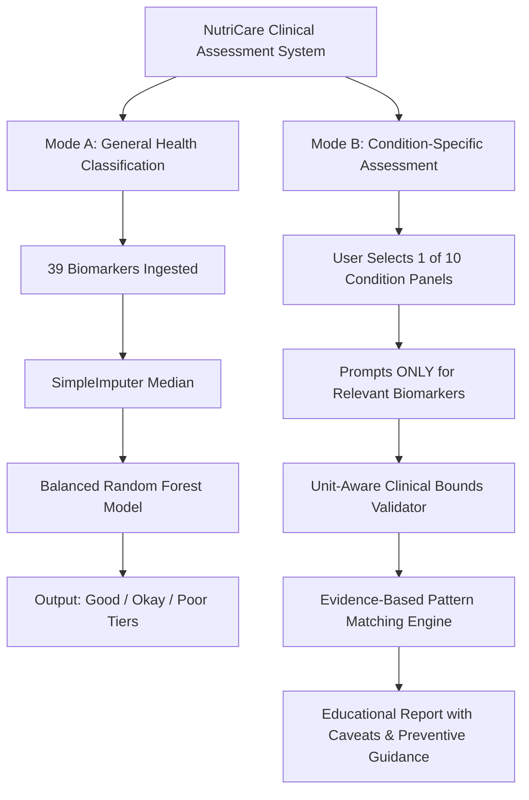

# Project-Model: NutriCare ML — Blood Biomarker Analysis & Clinical Pattern Assessment

A comprehensive, standalone health-data machine learning and clinical pattern assessment system demonstrating biomarker classification into three synthetic health tiers (**Good**, **Okay**, **Poor**) and targeted, unit-aware **condition-specific pattern evaluations** across 10 clinical panels.

> **CRITICAL EDUCATIONAL & MEDICAL DISCLAIMER**  
> This project is designed strictly for **academic, educational, and technical demonstration** purposes.  
> - **NOT A MEDICAL DEVICE OR DIAGNOSTIC TOOL**: This software must **NEVER** be used for clinical diagnosis, patient triage, or treatment planning.  
> - **SYNTHETIC DATASET**: The underlying dataset contains synthetic biomarker values and rule-derived labels. High model accuracy reflects the algorithm learning synthetic threshold rules, **NOT** real-world medical diagnostic efficacy.  
> - **NO DISEASE-SPECIFIC SUPERVISED LABELS**: The dataset does **not** contain ground-truth clinical diagnostic labels for specific diseases. Condition assessments in Mode B are transparent, rule-based demonstrations grounded in clinical practice guidelines, **not** black-box supervised classifiers.  
> - **ALWAYS SEEK PROFESSIONAL CARE**: Any abnormal pattern warrants evaluation by a qualified, licensed physician.

---

## Table of Contents
1. [Project Overview & Dual Architecture](#1-project-overview--dual-architecture)
2. [Project Architecture & Directory Structure](#2-project-architecture--directory-structure)
3. [The 39 Biomarkers & Clinical Panels](#3-the-39-biomarkers--clinical-panels)
4. [Input Validation & Unit-Mismatch Engine](#4-input-validation--unit-mismatch-engine)
5. [Condition-Specific Clinical Pattern Engine (10 Panels)](#5-condition-specific-clinical-pattern-engine-10-panels)
6. [Installation & Setup](#6-installation--setup)
7. [Training the Supervised Model](#7-training-the-supervised-model)
8. [Running Assessments & Predictions](#8-running-assessments--predictions)
9. [Automated Testing & Verification](#9-automated-testing--verification)
10. [Evaluation Results (Mode A)](#10-evaluation-results-mode-a)
11. [Scientific Limitations & Supervised ML Requirements](#11-scientific-limitations--supervised-ml-requirements)
12. [Key ML & Clinical Concepts for Viva](#12-key-ml--clinical-concepts-for-viva)

---

## 1. Project Overview & Dual Architecture

NutriCare provides two complementary, modular workflows:



### Mode A: General Health Classification (Supervised ML)
- Uses an ensemble `RandomForestClassifier` trained on all 39 biomarkers to predict composite synthetic categories (`Good`, `Okay`, `Poor`).
- Features automated missing data imputation, class-weight balancing, and stratified train/test partitioning.

### Mode B: Condition-Specific Pattern Assessment (Targeted Clinical Panels)
- Eliminates user fatigue: users select a specific condition and are prompted **only for relevant biomarkers** with documented units.
- Validates inputs against physiological boundaries, catches non-numeric/negative errors, and detects **international unit mismatches** (e.g., glucose in mmol/L vs mg/dL, creatinine in µmol/L vs mg/dL).
- Assesses biomarker patterns against published medical consensus guidelines (ADA, WHO, KDIGO, AHA/ACC, ACG, ATA, Endocrine Society, BSH).
- Provides comprehensive educational narratives, differential diagnoses, unmeasured test caveats, and preventive lifestyle guidance.

---

## 2. Project Architecture & Directory Structure

```
Project-Model/
├── README.md                          # Root system documentation
├── .gitignore                         # Root Git ignore rules
├── TrainData.xlsx                     # Biomarker workbook (6 sheets)
└── NutriCare-ML/                      # Main application package
    ├── .gitignore                     # Module-level Git ignore
    ├── Process.md                     # Engineering handoff & build audit log
    ├── README.md                      # Detailed application documentation
    ├── requirements.txt               # Pinned Python package dependencies
    ├── TrainData.xlsx                 # Dataset workbook
    ├── train.py                       # Supervised training orchestration script
    ├── predict.py                     # Dual-mode CLI prediction tool
    ├── app.py                         # Textual interactive terminal dashboard
    ├── models/
    │   ├── nutricare_model.pkl        # Serialized Pipeline (median imputer + Random Forest)
    │   └── model_metadata.json        # Schema, metrics, and training metadata
    ├── outputs/
    │   ├── validation_report.txt      # 12-point dataset audit report
    │   ├── evaluation_report.txt      # Classification report & confusion matrix
    │   ├── disease_mapping_report.md  # Comprehensive biomarker audit
    │   └── confusion_matrix.png       # Confusion matrix visualization heatmap
    ├── src/
    │   ├── __init__.py                # Package initializer
    │   ├── config.py                  # Constants, paths & hyperparameters
    │   ├── data_loader.py             # Excel loader, validator & splitter
    │   ├── trainer.py                 # Pipeline builder & model evaluator
    │   ├── biomarker_validation.py    # Unit-aware bounds validator & alert engine
    │   ├── disease_patterns.py        # Rule-based clinical pattern engine (10 panels)
    │   ├── disease_explainer.py       # Educational clinical explainer
    │   └── tui/                       # Gemini & Hermes inspired interactive TUI
    │       ├── __init__.py
    │       ├── app.py                 # Main Textual App orchestrator
    │       ├── chat_engine.py         # Conversational NLP biomarker assistant
    │       ├── charts.py              # Unicode block charts & visualizations
    │       ├── logo.py                # 24-bit true-color gradient ASCII branding
    │       ├── screens.py             # Interactive screens (Chat, Form, Panels, etc.)
    │       ├── theme.tcss             # High-contrast modern dark-mode stylesheet
    │       └── widgets.py             # Reusable UI widgets & status cards
    └── tests/
        ├── test_biomarker_validation.py # Unit tests for clinical validation (20 tests)
        ├── test_chat_engine.py          # Conversational biomarker NLP tests (10 tests)
        └── test_tui.py                  # Headless TUI integration tests (17 tests)
```

---

## 3. The 39 Biomarkers & Clinical Panels

The 39 continuous numeric biomarkers in `TrainData.xlsx` are grouped into physiological panels:

| Panel | Biomarkers Included | Canonical Units | Key Clinical Roles |
|---|---|---|---|
| **Metabolic & Glycemic** | `Glucose_mg_dL`, `HbA1c_pct` | mg/dL, % | Acute blood sugar and 3-month average glycemia |
| **Complete Blood Count (CBC)** | `Hemoglobin_g_dL`, `RBC_10^12_L`, `MCV_fL`, `MCH_pg`, `MCHC_g_dL`, `RDW_pct`, `WBC_10^9_L`, `Platelet_10^9_L`, `Neutrophil_10^9_L`, `Lymphocyte_10^9_L` | g/dL, $10^{12}/\text{L}$, fL, pg, g/dL, %, $10^9/\text{L}$ | Erythrocyte size/mass, oxygenation, infection, and platelet hemostasis |
| **Lipid Profile & Atherogenesis** | `Total_Cholesterol_mg_dL`, `LDL_Cholesterol_mg_dL`, `HDL_Cholesterol_mg_dL`, `Triglycerides_mg_dL`, `ApoB_mg_dL`, `Lipoprotein_a_mg_dL` | mg/dL | Circulating cholesterol, atherogenic particles (ApoB), and genetic cardiovascular risk (Lp(a)) |
| **Renal Function Panel** | `Creatinine_mg_dL`, `eGFR_mL_min_1_73m2`, `Urea_mg_dL`, `UACR_mg_g` (urine) | mg/dL, $\text{mL/min/1.73m}^2$, mg/dL, mg/g | Glomerular filtration, nitrogenous waste, and microvascular permeability |
| **Hepatic Chemistries** | `ALT_U_L`, `AST_U_L`, `ALP_U_L`, `Bilirubin_mg_dL`, `GGT_U_L`, `Albumin_g_dL` | U/L, mg/dL, g/dL | Hepatocellular injury, biliary cholestasis, and hepatic protein synthesis |
| **Endocrine & Thyroid** | `TSH_mIU_L` | mIU/L | Anterior pituitary regulator of thyroid hormone secretion |
| **Vitamins & Minerals** | `Vitamin_D_ng_mL`, `Vitamin_B12_pg_mL`, `Folate_ng_mL`, `Ferritin_ng_mL` | ng/mL, pg/mL, ng/mL, ng/mL | Bone mineral metabolism, DNA synthesis, and total body iron storage |
| **Electrolytes** | `Sodium_mmol_L`, `Potassium_mmol_L`, `Calcium_mg_dL`, `Magnesium_mg_dL` | mmol/L, mg/dL | Transmembrane neuromuscular excitability and cardiac rhythm regulation |
| **Vascular & Inflammatory** | `CRP_mg_L`, `Homocysteine_umol_L` | mg/L, µmol/L | Systemic acute-phase inflammation and one-carbon methylation |

*(Note: `Record_ID` is a non-clinical string identifier and is strictly excluded from all models. `UACR_mg_g` is a urine measurement; all other analytes are serum or whole blood).*

---

## 4. Input Validation & Unit-Mismatch Engine

The `BiomarkerValidator` module in `NutriCare-ML/src/biomarker_validation.py` provides unit-aware input validation:

1. **Non-Numeric & Malformed Input**: Rejects alphabetic characters, invalid floats, `NaN`, and infinities.
2. **Physiologically Impossible Values**: Catches negative numbers and values outside biological survival limits (e.g., negative HbA1c, 0 WBC, HbA1c > 25%).
3. **Suspicious International Unit Mismatches**:
   - **Glucose**: Values in 2.0 - 30.0 range trigger a warning: *"Did you enter glucose in mmol/L instead of mg/dL?"*
   - **Creatinine**: Values in 40.0 - 1500.0 range trigger a warning: *"Did you enter creatinine in µmol/L instead of mg/dL?"*
   - **Cholesterol**: Values in 2.0 - 15.0 range trigger a warning: *"Did you enter total cholesterol in mmol/L instead of mg/dL?"*
   - **Hemoglobin**: Values in 50.0 - 220.0 range trigger a warning: *"Did you enter hemoglobin in g/L instead of g/dL?"*
   - **Calcium**: Values in 1.5 - 3.5 range trigger a warning: *"Did you enter calcium in mmol/L instead of mg/dL?"*
4. **Critical / Panic Laboratory Alerts**: Flags acute life-threatening derangements (e.g., Potassium < 2.8 or > 6.2 mmol/L, Sodium < 120 or > 155 mmol/L, Platelets < 30) requiring immediate medical attention.
5. **No Silent Imputation or Clipping**: Invalid inputs are clearly reported with specific diagnostic messages without silent data alteration.

---

## 5. Condition-Specific Clinical Pattern Engine (10 Panels)

The `DiseasePatternEngine` in `NutriCare-ML/src/disease_patterns.py` evaluates targeted panels:

1. **Diabetes-Related Screening**: Evaluates `Glucose_mg_dL` and `HbA1c_pct` against ADA consensus criteria (Normal: HbA1c < 5.7%; Prediabetes: 5.7%-6.4%; Diabetic Range: $\ge 6.5\%$).
2. **Anemia Patterns (Morphologic Classification)**: Evaluates `Hemoglobin_g_dL` and categorizes morphology via `MCV_fL` with `RDW_pct` anisocytosis assessment.
3. **Iron Deficiency Patterns**: Evaluates `Ferritin_ng_mL` alongside hemoglobin, MCV, and `CRP_mg_L` to identify functional iron deficiency.
4. **Cholesterol & Lipid Abnormalities**: Evaluates Total Cholesterol, LDL, HDL, Triglycerides, `ApoB_mg_dL`, and `Lipoprotein_a_mg_dL` against NCEP ATP III / AHA guidelines.
5. **Kidney Function Abnormalities**: Evaluates `Creatinine_mg_dL`, `eGFR_mL_min_1_73m2` (KDIGO Stages G1 to G5), `Urea_mg_dL`, and urine albuminuria (`UACR_mg_g` Stages A1 to A3).
6. **Liver-Related Abnormalities**: Differentiates hepatocellular injury (ALT/AST $\ge 3\times$ ULN), cholestasis (concordant ALP and GGT elevation), and hyperbilirubinemia.
7. **Thyroid Dysfunction Indicators**: Evaluates `TSH_mIU_L` for suspected primary hypothyroidism (>4.0 mIU/L) or hyperthyroidism (<0.4 mIU/L).
8. **Vitamin D Deficiency Patterns**: Evaluates `Vitamin_D_ng_mL` (Deficiency <20 ng/mL, Severe <12 ng/mL) and concomitant calcium/ALP changes.
9. **Vitamin B12 & Folate Deficiency**: Evaluates B12, folate, `Homocysteine_umol_L`, and macrocytosis.
10. **Electrolyte Abnormalities**: Evaluates sodium, potassium, calcium (with albumin correction), and magnesium for critical conduction or osmolar risks.

---

## 6. Installation & Setup

### Prerequisites
- Python 3.10, 3.11, 3.12, or 3.13 installed
- Windows, macOS, or Linux

### Installation Commands

```bash
# 1. Navigate to the NutriCare-ML directory
cd NutriCare-ML

# 2. Create a virtual environment
python -m venv venv

# 3. Activate the virtual environment
# Windows (PowerShell):
.\venv\Scripts\Activate.ps1
# Windows (Command Prompt):
.\venv\Scripts\activate.bat
# macOS / Linux:
source venv/bin/activate

# 4. Install dependencies
pip install -r requirements.txt
```

---

## 7. Training the Supervised Model

To execute the data validation, training, and evaluation pipeline:

```bash
cd NutriCare-ML
python train.py
```

This validates `TrainData.xlsx`, fits the median imputer and balanced Random Forest classifier, evaluates on a 20% stratified test split, and generates:
- `models/nutricare_model.pkl`
- `models/model_metadata.json`
- `outputs/validation_report.txt`
- `outputs/evaluation_report.txt`
- `outputs/confusion_matrix.png`

---

## 8. Running Assessments & Predictions

### 1. Interactive Terminal Dashboard & Conversational Assistant (Recommended)
Launch the dark-mode terminal application built with Textual:

```bash
cd NutriCare-ML
python app.py
```

Features:
- **Conversational Assistant (Hermes-inspired)**: Extract biomarker values from natural English statements, load presets, and execute predictions seamlessly.
- **Manual 39-Biomarker Form**: Side-by-side split workspace with instant preset testing (Good, Okay, Poor).
- **10 Condition Panels**: Targeted assessments prompting only for relevant laboratory values.
- **Live Visual Analytics**: Horizontal terminal charts for dataset distribution and model performance.

### 2. Command-Line Interface (Headless / Scripting)
```bash
cd NutriCare-ML

# Run interactive CLI
python predict.py

# Run Mode A demo (Good / Okay / Poor test cases)
python predict.py --demo

# Run Mode B demo (Condition assessment test cases)
python predict.py --demo-conditions
```

---

## 9. Automated Testing & Verification

Run the full automated test suite:

```bash
cd NutriCare-ML
python -m unittest discover tests
```

**Test Suite Coverage (47 Tests Total - 100% Pass Rate)**:
- `tests/test_biomarker_validation.py` (20 tests): Input boundaries, panic values, unit mismatches, and 10 condition pattern engines.
- `tests/test_chat_engine.py` (10 tests): Natural language parsing, alias extraction, and conversational prediction commands.
- `tests/test_tui.py` (17 tests): UI lifecycle, screen navigation, preset loading, chart rendering, and stress testing.

---

## 10. Evaluation Results (Mode A)

Evaluated on the held-out 20% test set (200 records):

| Model | Test Accuracy | Macro-F1 | Notes |
|---|---|---|---|
| **DummyClassifier (Baseline)** | 71.00% | 0.2768 | Predicts majority class (`Okay` / `MEDIUM`) |
| **NutriCare Random Forest** | **98.00%** | **0.9552** | **+27.00% Accuracy, +0.6784 Macro-F1** |

---

## 11. Scientific Limitations & Supervised ML Requirements

1. **Absence of Diagnostic Ground Truth**: The dataset contains synthetic records without real clinical diagnostic labels.
2. **Deterministic Label Rules**: Labels were generated via rules (`H1-H4`, `M1-M6`). The model learns these mathematical relationships rather than biological pathology.
3. **Missing Critical Analytes**: Key confirmatory tests (Free T4/T3, serum iron, TIBC, fasting status) are omitted.
4. **Real-world Clinical ML Requirements**: Requires validated electronic health records (EHR) with ICD-10 codes, longitudinal follow-up, and demographic covariates.

---

## 12. Key ML & Clinical Concepts for Viva

- **Why Macro-F1 over Accuracy?**  
  Class imbalance is significant (71.2% Okay, 2.7% Poor). Macro-F1 treats all classes with equal weighting, ensuring high-risk minority cases are not masked.
- **Data Leakage Prevention:**  
  `SimpleImputer` is encapsulated inside a `Pipeline`, fitting median values strictly on training folds.
- **Unit Mismatch Detection:**  
  Heuristic verification flags international lab units (such as mmol/L entered for mg/dL glucose) to prevent dangerous misinterpretations.
- **Dual Architecture:**  
  Separates supervised synthetic health-tier classification from transparent, evidence-based clinical pattern analysis.
